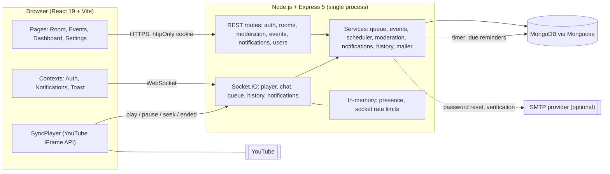

# SyncSpace upgrade notes

What changed, why, and how it works. Everything here describes code that exists in the repository and is covered by the tests listed in the README.

## Architecture

The original stack was verified against the source before any change: React 19 + Vite 6, Express 5, Mongoose 9, Socket.IO 4, zod, JWT in an httpOnly cookie. Nothing was migrated, no major dependency was upgraded, and no AI/ML package or service was added. The only new runtime dependency is `nodemailer` (SMTP email).

## Baseline before the upgrade

| Check | Result |
|---|---|
| Backend tests | 23 / 23 passed |
| Browser journey (`e2e/journey.py`) | 28 / 28 passed |
| Client build | succeeded |
| Client lint | 1 error (`process` undefined in `vite.config.js`), 3 warnings |

After the upgrade: backend 62 / 62 (two consecutive runs), journey 28 / 28, feature journey 28 / 28, build succeeds, lint 0 errors and 4 warnings (all “fast refresh” warnings about context files that also export a hook, the existing project pattern).

The three `.whl` files in `server/` (pymongo, dnspython, pymongo_inmemory) are not referenced by any code, script or documentation and are not needed by the Node server. They were **not deleted**; `*.whl` was added to `.gitignore` and you can remove them.

## Design decisions

### Shared queue
- **Where it lives:** `QueueItem` collection (one document per upcoming video); the playing video stays in `Room.playback`.
- **Order:** *By votes* (default): “Play next” items first, then most votes, then first added. *Manual*: the host’s order. Switching to manual freezes the order people were looking at. In votes mode a host/moderator can only use “Play next” (votes decide the rest); in manual mode they can move an item to any position.
- **Duplicates:** the same video can be queued once. A second add becomes a vote on the existing entry. A unique index `{room, videoId}` makes this hold even when two people add it at the same instant. The currently playing video cannot be queued.
- **Limits:** 50 per room, 10 waiting per person (moderators exempt).
- **Votes:** stored as a set of user ids on the item; add uses `$ne` guard + `$addToSet`, so repeats do nothing. Counts are always `votes.length` on the server.
- **Concurrency:** every mutation is a single atomic update or conditional delete. A `queueVersion` counter on the room increases with every change and clients ignore older snapshots. Removing or moving an item that someone else just took gives a clean `QUEUE_ITEM_NOT_FOUND`.
- **Advancing (idempotent):** (1) atomically delete the next entry, (2) switch `Room.playback` only if `playback.seq` is unchanged (compare-and-set), (3) if that fails, put the entry back. Many clients report “ended” at once and exactly one advance happens. A late report for a previous video is ignored. (MongoDB transactions are not used because the default deployment is a standalone server; the delete-then-compare-and-set sequence with compensation gives the same outcome here.)
- **Who can end a video:** anyone’s player reports `player:ended`, but the server only believes it when its own clock agrees the video is within 3 s of the duration a controller reported (`player:duration`). Without a known duration only controllers are trusted. This stops a member skipping early.
- **Unavailable video:** a controller can skip alone; otherwise a strict majority of people online must report.
- **If nothing is queued** when a video ends, the room pauses at the end.

### Scheduled watch parties
- A party creates its room immediately (reusing existing room rules for visibility, capacity and guest control), so the invitation is a real room. `Room.scheduledStartAt` keeps the room from expiring before the party (`expiresAt = max(now + TTL, start + TTL)`).
- Times are stored as UTC instants. The form sends the local wall-clock time converted to UTC plus the organiser’s IANA zone; every viewer sees it in their own zone, with the organiser’s time shown when the zones differ.
- Phase (`upcoming`, `ongoing`, `completed`, `cancelled`) is derived from the clock, never stored.
- **Access:** organiser, invited users, people who answered, room members, and anyone for public parties. A private party that you can’t access returns 404 (its existence isn’t revealed). The secret invite link works until the party ends (then `INVITE_EXPIRED`) and can be rotated. The room code is only shown to people already inside the room; others enter through `POST /events/:id/join`, which enforces the early-entry window (15 min), bans, locks and capacity.
- **Email invites** never reveal whether an address has an account (same response either way). Invited users get an in-app notification.
- **Reminders:** a scheduler polls MongoDB every 30 s. State is persisted (`reminderSentFor`), notifications use a unique `dedupeKey` per person and start time, and the event is re-read just before and after sending. Result: no duplicates across repeated runs, parallel workers or restarts; a rescheduled or cancelled party withdraws its unread reminders; a party that ended while the server was down gets no reminder; one already running gets “started N minutes ago”.

### Notifications
`Notification` documents are always queried by the signed-in user, so one person can never read or change another’s. Types: event invite, reminder, update, cancellation, membership/moderation, report outcome, account. Links are validated as in-app paths. Delivered live to the user’s `user:<id>` socket channel (all tabs). Kept 90 days (TTL index). No email notifications are sent.

### Moderation
| Action | Host | Moderator | Member |
|---|---|---|---|
| Appoint / remove moderators | yes | no | no |
| Mute / unmute, temporary or permanent ban, remove | anyone but themselves | ordinary members only | no |
| Unban | yes | yes, except bans the host issued | no |
| Set slow mode | yes | no | no |
| See and review reports | yes (except about themselves) | yes (including about the host, but no punishment is possible) | no |
| Report a person or message | yes | yes | yes |

Mutes and bans accept 1 minute to 30 days (or indefinite). Expired restrictions are ignored when read, so no cleanup job is needed. Slow mode and mute are enforced in the socket handlers (`chat:send`, `reaction:send`) from the database, so they survive restarts. Reports store only the reason, an optional note (300 chars) and a snapshot of the reported message; one open report per reporter/target/message; 8 reports per hour per user. Every privileged action is written to `ModLog` (kept 180 days). Deleted users appear as “Deleted user”.

### Account security
- **Logout** now revokes the session: tokens carry a `jti`; signing out stores it in `RevokedToken` (TTL’d) and the auth middleware and socket handshake reject it. Tokens issued before the upgrade have no `jti` and stay valid until they expire or you use “sign out everywhere”.
- **Password reset:** 32-byte random token, only its SHA-256 hash is stored, expires in 30 minutes, single use (atomic consume), a newer request invalidates older ones, success bumps `tokenVersion` (signs out every device). Same answer for known and unknown emails; at most 3 emails per address per hour; the endpoints are rate limited. If email isn’t configured the API answers `503 EMAIL_NOT_CONFIGURED` and the UI says so. If the provider refuses delivery, the API answers `502 EMAIL_DELIVERY_FAILED`. “Sent” is only claimed after the SMTP server accepted the message.
- **Email verification:** link emailed on sign-up and on request; it does not block using the app.
- **CSRF / CORS assessment:** the cookie is httpOnly. The CORS middleware rejects any request, including POST, whose `Origin` is not on the allow-list before it reaches a route, which is what blocks cross-site form posts; a test covers it. Production defaults to `SameSite=None; Secure` (needed when the API is on another site); set `COOKIE_SAMESITE=lax` when both are on one origin. Passwords are bcrypt (cost 12).

### Watch history
One document per user per video (`WatchHistory`): last position, duration, completed (≥95%), times watched, last room name. Progress is saved by `history:progress` from the player every 15 s while it plays; the server accepts it only for the video the room is currently playing, with plausible numbers, from members, rate limited, and only if the user has history on. It is **separate from the watchlist** and **never changes shared playback**: “Resume” creates a *new* room at your own position. Room links only show while you are still an active, unbanned member. Retention: 180 days since last watched (TTL index); users can delete one entry, clear everything, or turn history off in Settings.

### Backend quality
Structured JSON logging with secret redaction and request ids (`X-Request-Id`), `/api/health` (liveness) and `/api/ready` (database ping, 503 when unavailable), database outage mapped to 503, graceful shutdown with a 10 s hard stop and scheduler cleanup, Mongoose `new: true` deprecation fixed, zod validation on every new route and socket event, bounded pagination everywhere, indexes for every new query path.

## Database changes (backward compatible, no migration script)

Existing documents keep working: every new field has a default.

| Collection | Change |
|---|---|
| `users` | `emailVerifiedAt`, `preferences.saveHistory` (default true) |
| `rooms` | member `role` may be `moderator`; member `bannedUntil`, `bannedBy`, `muted`, `mutedUntil`; room `slowModeSeconds`, `queueMode`, `queueVersion`, `scheduledStartAt`; `playback.duration`, `playback.queueItemId` |
| new | `queueitems`, `notifications`, `watchevents`, `reports`, `modlogs`, `emailtokens`, `revokedtokens`, `watchhistories` |

New indexes are created at startup by the existing `syncIndexes()` call in `server/src/index.js`. Existing bans (`removed: true`, no `bannedUntil`) remain permanent. Rolling back the code leaves the extra fields and collections unused; nothing is dropped.

## API and socket additions

See [API.md](API.md) for the full list. Summary:
- REST: `/api/events*`, `/api/notifications*`, `/api/rooms/:code/{queue,mute,unmute,ban,unban,moderators,moderation,moderation/log,reports}`, `/api/users/me/history*`, `/api/auth/{config,forgot-password,reset-password,verify-email,resend-verification}`, `/api/ready`.
- Socket (client → server): `queue:get|add|vote|remove|move|mode|next|unavailable`, `player:ended`, `player:duration`, `history:progress`. Server → client: `queue:update`, `notification:new`, `notification:count`. New chat errors: `MUTED`, `SLOW_MODE` (with `retryAfter`).

## Scaling (Redis evaluation)

Not added. A Redis adapter for Socket.IO would only fan out events between instances. SyncSpace also keeps presence, socket rate limits, host-handover timers and the “unavailable video” counter in process memory, and each instance would run its own scheduler (safe, because reminders are idempotent in MongoDB, but wasteful). Running more than one instance therefore needs the adapter **and** shared presence/limiter state. Everything persistent (rooms, queue, events, notifications, history) is already in MongoDB, so a single instance is correct and simple for this project’s scale.

## Known limitations
See README “Limitations”. In short: single instance, email needs an SMTP provider, queue titles for pasted links show as “YouTube video”, queue auto-advance needs a controller to have reported the duration, reminders are in-app only and can be up to ~30 s late.

## Final-year demonstration checklist

1. Start MongoDB, `npm run dev:server`, `npm run dev:client`; open two browsers (one private window).
2. Sign up two users. Show the unchanged landing, dashboard and room.
3. **Sync (existing):** create a room, join with the invite link, play/pause/seek on one screen and show the other follow; refresh one tab.
4. **Queue:** open the Queue tab on both; add two videos from different users; vote and watch the order change on both screens; try as a guest to remove the host’s item (no control); as host switch to Manual and reorder; reload to show persistence; let a video end (or press Skip) and show everyone moves on together.
5. **Moderation:** host appoints the guest as moderator, mutes/unmutes a member (they can’t type), sets slow mode, report a message, open Moderation and show the report, the restrictions list and the audit log.
6. **Scheduled party:** Events → Schedule; set a time ~16 min away; invite the other user by email; show the bell badge and the live notification; RSVP; when within the window show the reminder and the enabled Join button; reschedule and show the old reminder disappear; cancel and show the cancellation notice.
7. **Account security:** Settings → turn watch history off/on; sign in on two browsers, sign out on one and show the copied session no longer works; with SMTP configured run Forgot password end to end (without SMTP show the honest “email isn’t set up” message).
8. **Operations:** `GET /api/health`, `GET /api/ready`, stop MongoDB and show `/api/ready` returns 503; `npm test` (62 tests) and `python3 e2e/features.py`.

## Resume bullets (only what is verified)

- Extended a MERN + Socket.IO watch-party app with a persistent, collaborative video queue (voting, manual ordering, auto-advance) using atomic MongoDB updates, compare-and-set playback transitions and a unique index; verified under simultaneous clients and a server restart.
- Built scheduled watch parties with UTC storage and per-viewer time zones, secret rotating invite links, RSVP with capacity checks and a MongoDB-backed reminder scheduler that is idempotent across restarts and parallel workers.
- Implemented real-time in-app notifications (unread counts, paging, per-user authorization, de-duplication) delivered over per-user Socket.IO channels.
- Designed a moderation system (host/moderator roles, mutes, expiring bans, slow mode, reports, audit log) with server-side permission checks in REST and socket handlers.
- Hardened authentication: hashed single-use expiring reset tokens, email verification via SMTP, server-side session revocation on logout, rate limiting and CORS/cookie review.
- Grew automated coverage from 23 to 62 backend integration tests against a real MongoDB plus two multi-browser Playwright journeys (28 checks each); added structured logging, health/readiness endpoints, graceful shutdown and a GitHub Actions pipeline.
